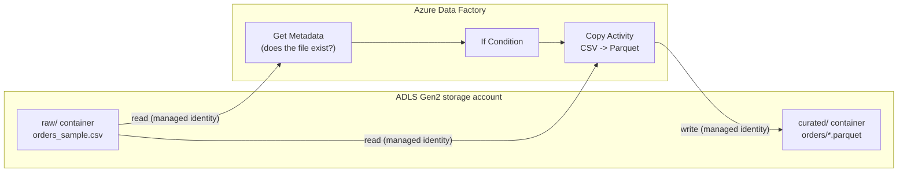

# ADF + ADLS Gen2 Mini Pipeline

A small, self-contained data engineering project built on a free Azure account: a synthetic CSV lands in **Azure Data Lake Storage Gen2**, and an **Azure Data Factory** pipeline validates and converts it to **Parquet**, authenticating with the Data Factory's own managed identity — no stored keys or secrets anywhere.

## Architecture



- **Storage**: one ADLS Gen2 account (hierarchical namespace enabled), two containers — `raw` and `curated`.
- **Compute/orchestration**: one ADF pipeline, three activities — `GetMetadata` → `IfCondition` → `Copy`. No Mapping Data Flows (those spin up Spark compute and cost money — not worth it for a free-tier demo).
- **Security**: the linked service to ADLS Gen2 uses the Data Factory's **system-assigned managed identity**, granted the `Storage Blob Data Contributor` role on the storage account. No account keys or connection strings anywhere in the project.

## Repo layout

```
adf-adls-portfolio/
├── data/
│   ├── generate_sample_data.py   # regenerates the sample CSV (stdlib only)
│   └── sample/
│       ├── orders_sample.csv     # 200-row synthetic orders file, ready to upload
│       └── orders_sample.parquet # actual pipeline output, downloaded from curated/orders/
└── pipeline/
    ├── linkedService_ADLSGen2.json
    ├── dataset_RawOrdersCsv.json
    ├── dataset_CuratedOrdersParquet.json
    └── pipeline_CopyOrdersToCurated.json
```

The `pipeline/*.json` files are exported from the deployed ADF pipeline.

## Setup (Azure Portal)

1. **Resource group** — create `rg-adf-portfolio` (or any name) in a region close to you.
2. **Storage account (ADLS Gen2)** — create a storage account in that resource group with **Enable hierarchical namespace** turned on under the Advanced tab. In Storage Browser (or Storage Explorer), create two containers: `raw` and `curated`.
3. **Data Factory** — create a Data Factory instance (V2) in the same resource group. Open it in **ADF Studio**.
4. **Grant access** — on the storage account, go to **Access control (IAM)** → Add role assignment → `Storage Blob Data Contributor` → assign to the Data Factory's managed identity (search by the Data Factory's name).
5. **Linked service** — in ADF Studio → Manage → Linked services → New → Azure Data Lake Storage Gen2 → pick the storage account → Authentication method: **System Assigned Managed Identity**. (Reference: `pipeline/linkedService_ADLSGen2.json`.)
6. **Datasets** — create:
   - `ds_raw_orders_csv`: DelimitedText, pointing at `raw/orders_sample.csv`, first row as header.
   - `ds_curated_orders_parquet`: Parquet, pointing at `curated/orders/`.
7. **Pipeline** — build `pl_copy_orders_to_curated`:
   - `GetMetadata` on `ds_raw_orders_csv`, field: `Exists`.
   - `IfCondition` on `@activity('Check source file exists').output.exists`.
   - Inside the True branch: `Copy` activity from `ds_raw_orders_csv` to `ds_curated_orders_parquet`.
8. **Upload the sample file** — upload `data/sample/orders_sample.csv` into the `raw` container (Storage Browser, drag-and-drop works fine).
9. **Run it** — trigger the pipeline manually from ADF Studio (**Debug** or **Add trigger → Trigger now**; no scheduled trigger needed, which avoids any recurring cost). Confirm in **Monitor** that the run succeeded, and confirm a `.parquet` file now exists under `curated/orders/` in Storage Browser.
10. **Save the pipeline JSON back to this repo** — in ADF Studio, open each resource's **Code** view and copy its JSON into the matching file under `pipeline/`, replacing the reference versions.

## Results

Pipeline run succeeded end-to-end (all three activities green in Monitor):

| Activity | Status | Duration |
|---|---|---|
| Check source file exists (GetMetadata) | Succeeded | 10s |
| If source file exists (IfCondition) | Succeeded | 25s |
| Copy CSV to curated Parquet (Copy) | Succeeded | 23s |

Output: a single Parquet file (6.6 KiB, converted from the 200-row/~9 KB source CSV) landed in `curated/orders/` in Storage Browser, confirming the managed-identity-authenticated read from `raw/` and write to `curated/` both worked with no keys or secrets involved.

## Cleanup

This is a free-tier account — **delete the resource group** (`rg-adf-portfolio`) once you're done demoing or recording, to make sure nothing keeps billing.

## What this project covers

- **Azure Data Factory** — a multi-activity pipeline (GetMetadata, IfCondition, Copy), not just a bare copy job.
- **Azure Data Lake Storage Gen2** — a hierarchical-namespace storage account with a raw/curated zone split.
- **Parquet** — the pipeline's sink format, converted from CSV.
- **Security / access management** — managed-identity auth end-to-end, no keys or secrets in config.
- **Pipeline reliability** — an explicit file-existence check before attempting the copy.

**Would extend with, given more scope**: a Synapse serverless SQL pool or Spark pool for querying/transforming the curated Parquet data (PySpark), CI/CD for the pipeline definitions via GitHub Actions + the ADF `npm` validate/publish tooling, and Bicep/ARM templates so the whole environment is provisioned from code rather than clicked through the Portal.
